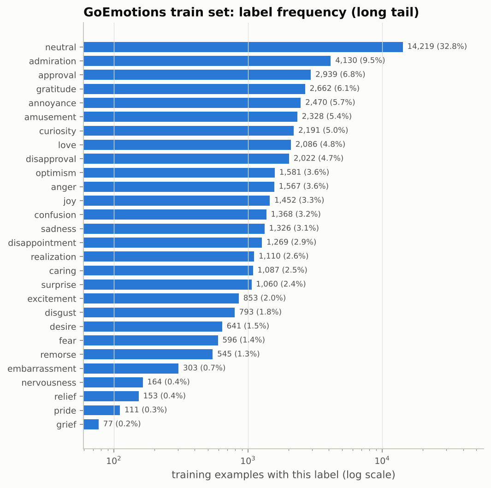
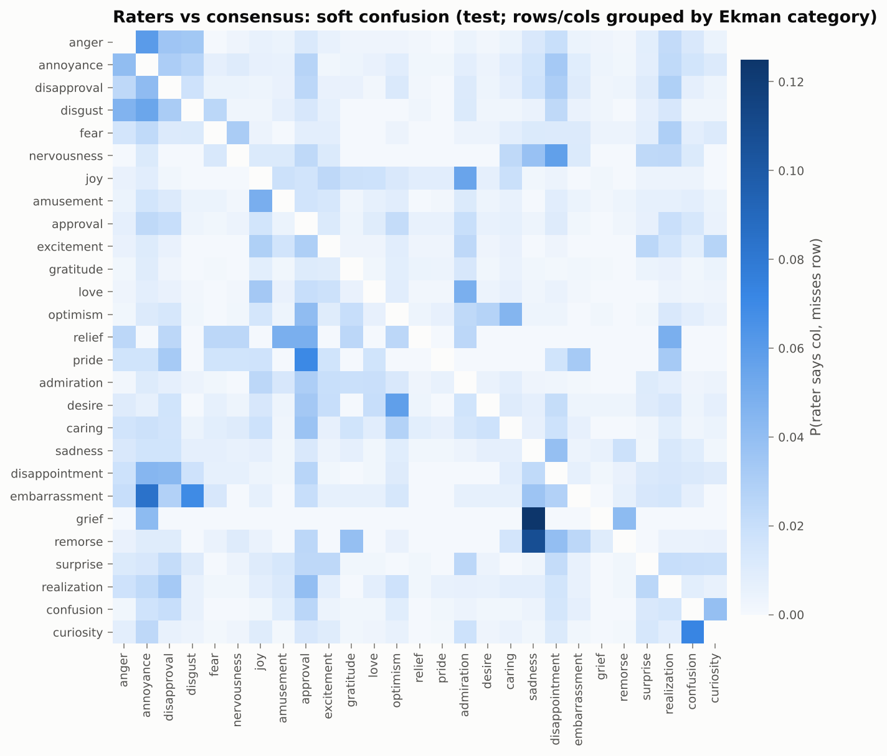
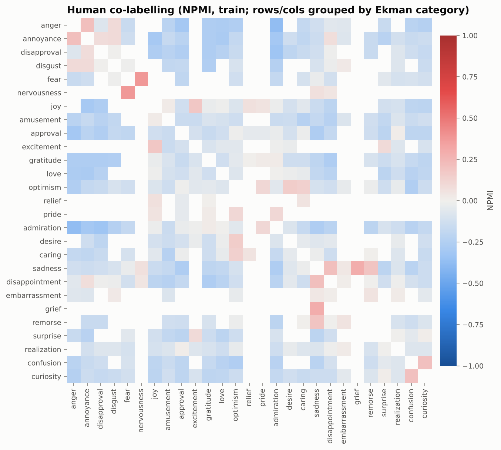

# Circumplex

**Do emotion classifiers organise feelings the way psychology says people do?**
Circumplex trains three tiers of models on GoEmotions (58k Reddit comments, 27
emotions + neutral, multi-label): TF-IDF + logistic regression, a BiLSTM written
from scratch, and RoBERTa-base (full fine-tuning and LoRA). Every neural model
uses one hand-written PyTorch training loop. The trained models are then used
as research instruments. Do their mistakes follow distance in Russell's
valence/arousal circumplex? Does their embedding space rediscover valence and
arousal without being told about them? Do they keep the mixed emotions humans
label, or collapse to one? Does emotion knowledge transfer to detecting CBT
"thinking traps"?

> **Not a mental-health tool.** This is a research and learning project. Its models
> guess which labels Reddit annotators might apply to short English comments.
> They must not be used to assess, diagnose or make decisions about anyone.

**Status:** code, tests, CI, notebooks and the classical baseline are done and
verified. GPU results are `TBD` until the Kaggle notebook has been run. No number
in this README was typed by hand: each one comes from a file in `runs/`.

---

## Research questions

| | Question | How it is tested |
|---|---|---|
| **RQ1** | How much does a pretrained transformer beat classical and from-scratch baselines, and where does the gap come from? | Test macro-F1 with bootstrap CIs, paired permutation tests, per-class F1 against class frequency |
| **RQ2** | Do model confusions follow psychological distance? | Soft confusion matrix vs Euclidean distance in NRC-VAD valence/arousal space; Spearman ρ + Mantel permutation test (10,000 relabellings); same for human raters; model vs human |
| **RQ3** | Does the embedding space recover valence/arousal it was never trained on? | Ridge probes per layer (fine-tuned vs pretrained-only vs random-init), PCA of emotion means vs valence/arousal, plus a control that probes the model's own 28 outputs |
| **RQ4** | Does the model reproduce human mixed-emotion patterns? | NPMI co-occurrence (human vs model), label cardinality distributions |
| **RQ5** | Does emotion fine-tuning help detect cognitive distortions, especially with little data? | Learning curves at 10/25/50/100% of the thinking-traps data, 3 seeds, vanilla vs GoEmotions-tuned encoder |

## Headline findings

Results from real runs only. Anything not yet run is `TBD`.

1. **A tuned classical baseline is strong.** TF-IDF + one-vs-rest logistic regression
   reaches **0.471 test macro-F1 (95% CI 0.448 to 0.490)** on CPU in under a minute.
   *(Real run, CPU.)*
2. **Per-class thresholds matter more than the model choice at the low end.** The same
   baseline at a fixed 0.5 threshold scores **0.287**, because it predicts only 0.57
   labels per example (humans average 1.17). Tuning one threshold per class on dev
   gives +0.18 macro-F1. *(Real run, CPU.)*
3. **Human raters confuse nearby emotions.** In the rater-level data, the
   most-confused pairs (rater says one, consensus says the other) are grief/sadness,
   remorse/sadness, confusion/curiosity and anger/annoyance. The most co-labelled
   pairs (NPMI) are fear/nervousness, grief/sadness and anger/annoyance. *(Real data.)*
   Whether this follows valence/arousal distance statistically is **TBD** (it needs
   the NRC VAD table).
4. RQ1 transformer gap: **TBD**
5. RQ2 model confusion vs VA distance: **TBD**
6. RQ3 probing: **TBD**
7. RQ4 model co-occurrence and cardinality: **TBD**
8. RQ5 transfer: **TBD**

## Results (RQ1)

Test set (5,427 comments). Macro-F1 uses per-class thresholds tuned on dev. The CI
is a 1,000-replicate percentile bootstrap over test examples. "± std" is over
seeds 42/43/44.

| Model | Test macro-F1 (tuned) | 95% CI | macro-F1 @0.5 | micro-F1 | Trainable params | Train time |
|---|---|---|---|---|---|---|
| TF-IDF + LR (C=1, dev-tuned) | **0.471** | [0.448, 0.490] | 0.287 | 0.558 | 4,079,852 | 0.4 min (CPU) |
| BiLSTM (from scratch) | TBD | TBD | TBD | TBD | TBD | TBD |
| RoBERTa-base, LoRA r=8 | TBD | TBD | TBD | TBD | TBD | TBD |
| RoBERTa-base, full fine-tune | TBD | TBD | TBD | TBD | TBD | TBD |
| GoEmotions paper, BERT-base | TBD (verify against Table 4 of Demszky et al. 2020 before citing) | | | | | |

Ekman-level and sentiment-level F1, ECE and the ablations (pos_weight, focal loss,
LoRA rank 16, BiLSTM max-pooling) are produced in `runs/analysis/results_table.md`
by `make analysis`. Pairwise significance (paired bootstrap + approximate
randomization, 10,000 permutations) goes in `runs/analysis/analysis.json`.

**Leakage check** (`scripts/check_leakage.py`, real). No comment id appears in two splits, the vectorizer is fit on train only, and thresholds and hyperparameters are chosen on dev only. Some short generic comments do repeat verbatim across splits (32 exact train/test text matches, e.g. "Thank you.", "This is amazing"), covering 42 test items once case and whitespace are normalised. Dropping those 42 lowers the baseline from 0.471 to **0.463 (95% CI 0.444 to 0.479)**, a small drop inside the original CI. The Kaggle notebook reports this deduplicated score for every model. One process caveat: I saw the test score of a first, hand-picked setting (C=4, balanced, 0.460) before running the dev sweep. The final setting (C=1) was chosen by dev score alone.

The baseline's hyperparameters were chosen on **dev** (`scripts/tune_tfidf.py`;
results in `runs/tfidf_sweep.json`). C ∈ {0.5, 1, 2, 4, 8} × class_weight ∈ {none,
balanced}. Every setting lands within 0.02 dev macro-F1 once thresholds are tuned.

## Figures

Figures are regenerated by `make analysis` (or `notebooks/analysis.ipynb`). The ones
present now come from real data or the real baseline run. The rest appear after
the Kaggle run.

| Figure | Status |
|---|---|
|  Label frequency: a 185× gap between `neutral` (14,219) and `grief` (77) | real data |
|  Raters vs consensus soft confusion (test set) | real data |
|  Human co-labelling (NPMI, train) | real data |
| `figures/rq1_per_class_f1.png`, `figures/calibration.png` | baseline only for now |
| `figures/rq2_model_confusion_vs_distance.png`, `rq2_human_confusion_vs_distance.png` | TBD (needs model + VAD) |
| `figures/rq3_layerwise_valence.png`, `rq3_layerwise_arousal.png`, `rq3_pca_*.png` | TBD |
| `figures/rq4_model_npmi.png`, `rq4_cardinality.png` | TBD |
| `figures/rq5_learning_curves.png` | TBD |
| `figures/attributions.html` (Integrated Gradients highlights) | TBD |

## What I learned

> _Placeholder for the author to write after the GPU runs._

## How it works (short version)

```
GoEmotions TSV/HF ──► data.py ──► tokenizer/vocab ──► DataLoader (dynamic padding)
                                                   │
               ┌───────────────────────────────────┴───────────────────────────┐
               ▼                                                               ▼
     models/bilstm.py (from scratch)                       models/transformer.py (RoBERTa + own head, opt. LoRA)
               └───────────────────────────────┬───────────────────────────────┘
                                               ▼
                           train.py: one loop for both (AMP, grad accumulation, clipping,
                           warmup + linear decay, early stopping on dev macro-F1, best checkpoint)
                                               ▼
                           evaluate.py: per-class thresholds, F1, ECE, bootstrap, permutation tests
                                               ▼
                 analysis/: confusion (RQ2), probing (RQ3), co-occurrence (RQ4), attribution
                           transfer.py (RQ5)       demo/app.py (Gradio)
```

See **[LEARNING.md](LEARNING.md)** for a file-by-file walkthrough with worked numbers.

## Reproduce

```bash
make install       # pinned deps + package (Python 3.10+)
make test          # 56 unit tests
make smoke         # every training path on CPU, about 1 minute
make baseline      # TF-IDF + LR, real numbers, about 1 minute on CPU
make vad           # builds data/emotion_vad.csv from the official NRC VAD lexicon
make analysis      # all figures + runs/analysis/analysis.json from whatever is in runs/
```

GPU training runs in `notebooks/train_kaggle.ipynb` on a free Kaggle GPU (3 to 4 hours
in one session). Download `circumplex_results.zip`, unzip it at the repo root, and run
`make analysis`.

Every run writes `runs/<name>/` with the resolved `config.yaml` (plus git commit,
torch/CUDA versions, GPU name), `metrics.json`, `curve.csv`, `predictions.npz` and
`errors.jsonl` (the 50 most confident false positives). Python, NumPy and torch
(CPU + CUDA) are all seeded.

## Data and licences

| Resource | Source | Licence | Notes |
|---|---|---|---|
| GoEmotions (simplified splits) | HF `google-research-datasets/go_emotions` (config `simplified`), with the same files at github.com/google-research/google-research/tree/master/goemotions/data as fallback | Apache-2.0 (google-research repo) | 43,410 / 5,426 / 5,427, checked on load. Downloaded at runtime |
| GoEmotions rater-level data | storage.googleapis.com/gresearch/goemotions | same release | Only `id`, `rater_id`, label columns used. Author/subreddit columns dropped on load |
| Ekman + sentiment mappings | `ekman_mapping.json`, `sentiment_mapping.json` from the release | Apache-2.0 | vendored unchanged in `data/goemotions/` |
| NRC VAD Lexicon (Aug 2018 release; Mohammad, ACL 2018) | saifmohammad.com/WebPages/nrc-vad.html | Free for research use; commercial use requires a licence from NRC (as stated in the `textdata` R package docs; the official terms page could not be reached from the build sandbox, so confirm it there) | Downloaded at runtime into `data/cache/` (gitignored). The 27-row derived table `data/emotion_vad.csv` is also generated at runtime and gitignored. Nothing from the lexicon is committed |
| Thinking traps (Sharma et al., 2023) | github.com/behavioral-data/Cognitive-Reframing, `data/thinking_traps.jsonl` | CC BY-NC-ND 4.0 | 1,077 lines → 698 unique thoughts, 14 traps after merging spelling variants. Downloaded at runtime, never redistributed |

The Shreevastava & Foltz (2021) Kaggle distortion dataset was the other candidate. It
could not be inspected from the build environment (Kaggle was unreachable), and the
Sharma et al. data was directly downloadable with a clear licence, so that is what RQ5
uses.

## Limitations

- **Label quality.** In the raw release (checked here: 211,225 ratings of 58,011
  comments by 82 raters), most comments have 3 raters and about 31% have 5. The
  official splits keep labels that at least 2 raters agreed on (per the release
  README), so a label reflects the agreement of 2 people. The paper's own reliability
  analysis and published third-party audits of mislabelling exist. *TBD: read and cite
  those sources directly before quoting any error rate.* This project's own evidence
  is the rater-vs-consensus confusion matrix above.
- **Ceiling effects.** With noisy labels, "model vs label" agreement is capped. A
  model can be "wrong" where raters also disagree.
- **Reddit English only.** Comments are short and informal, with names and religions
  masked (`[NAME]`, `[RELIGION]`). Reddit's user base is not representative (it is commonly
  reported to skew young, male and US-based), so none of this generalises to other populations, languages or clinical text.
- **VA coordinates for labels, not texts.** Each emotion *word* gets one lexicon
  coordinate. The RQ3 probe target is the average of an example's label coordinates,
  a proxy rather than a rating of the text itself.
- **RQ3 is partly circular** for the fine-tuned model: the target is a function of the
  labels the model was trained on. That's why the pretrained-only, random-init and
  "probe the 28 outputs" controls exist (see LEARNING.md).
- **Human confusion uses the same raters as the consensus.** A rater's own vote
  counts toward the gold labels they are compared against, which biases human
  confusion downward. The pattern across pairs, not the absolute level, is what's
  compared.
- **RQ5 is small.** About 105 test examples and 14 classes. Seed variance will be
  large, so the conclusions will be correspondingly cautious.

## Ethics

- Not a diagnostic or clinical tool. The model card lists out-of-scope uses.
- No user profiling. Author and subreddit metadata are dropped when loading. Nothing
  aggregates predictions per person.
- The thinking-traps data is used only for research, under its NC-ND licence, and
  is not redistributed.

## Citations

- Demszky, D., Movshovitz-Attias, D., Ko, J., Cowen, A., Nemade, G., & Ravi, S. (2020). *GoEmotions: A Dataset of Fine-Grained Emotions.* ACL 2020. arXiv:2005.00547.
- Mohammad, S. M. (2018). *Obtaining Reliable Human Ratings of Valence, Arousal, and Dominance for 20,000 English Words.* ACL 2018.
- Russell, J. A. (1980). *A circumplex model of affect.* Journal of Personality and Social Psychology, 39(6), 1161–1178.
- Sharma, A., Rushton, K., Lin, I. W., Wadden, D., Lucas, K. G., Miner, A. S., Nguyen, T., & Althoff, T. (2023). *Cognitive Reframing of Negative Thoughts through Human-Language Model Interaction.* ACL 2023.
- Liu, Y. et al. (2019). *RoBERTa: A Robustly Optimized BERT Pretraining Approach.* arXiv:1907.11692.
- Hu, E. J. et al. (2021). *LoRA: Low-Rank Adaptation of Large Language Models.* arXiv:2106.09685.
- Sundararajan, M., Taly, A., & Yan, Q. (2017). *Axiomatic Attribution for Deep Networks.* ICML 2017.
- Lin, T.-Y., Goyal, P., Girshick, R., He, K., & Dollár, P. (2017). *Focal Loss for Dense Object Detection.* ICCV 2017.
- Mantel, N. (1967). *The detection of disease clustering and a generalized regression approach.* Cancer Research, 27(2), 209–220.
